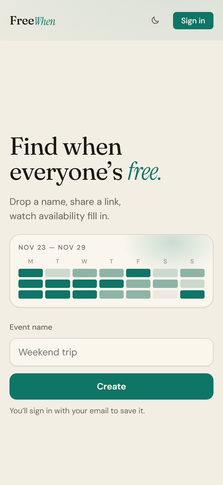
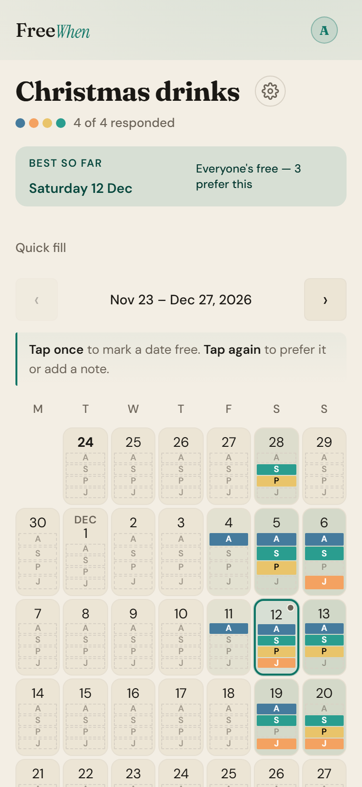
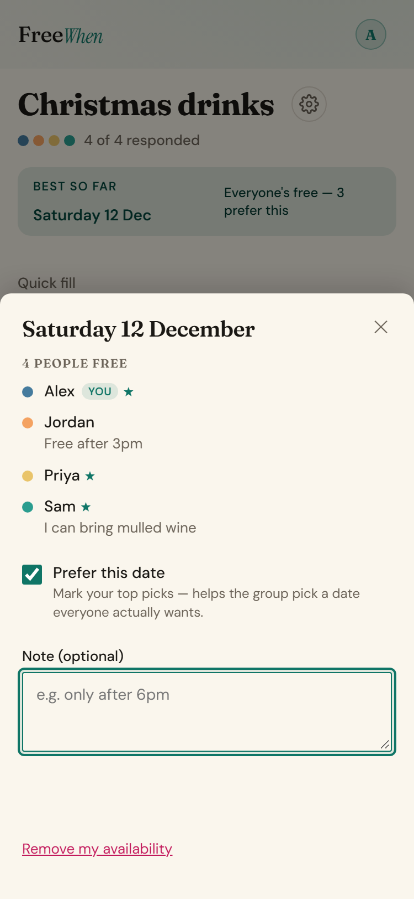
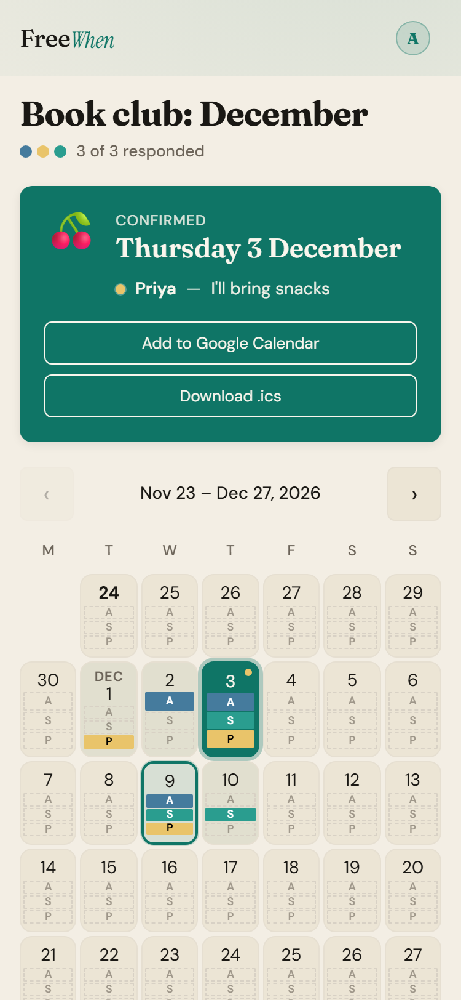
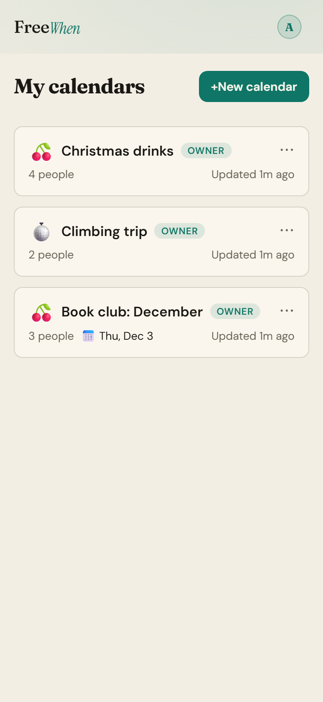
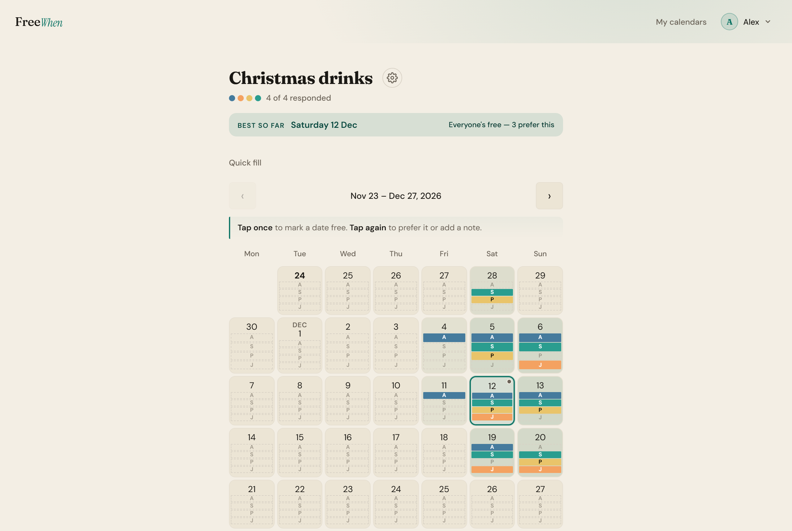

# FreeWhen

A dead-simple shared calendar for finding when a group is free.

Create a calendar, share the link, mark your available days. See everyone's availability at a glance.

## Screenshots

Mobile first: four friends picking a date for Christmas drinks (demo data).

| Landing | Calendar | Day sheet |
|:---:|:---:|:---:|
| <picture><source media="(prefers-color-scheme: dark)" srcset="docs/screenshots/landing-mobile-dark.png"></picture> | <picture><source media="(prefers-color-scheme: dark)" srcset="docs/screenshots/calendar-mobile-dark.png"></picture> | <picture><source media="(prefers-color-scheme: dark)" srcset="docs/screenshots/day-sheet-mobile-dark.png"></picture> |
| **Finalised** | **My calendars** | |
| <picture><source media="(prefers-color-scheme: dark)" srcset="docs/screenshots/finalised-mobile-dark.png"></picture> | <picture><source media="(prefers-color-scheme: dark)" srcset="docs/screenshots/my-calendars-mobile-dark.png"></picture> | |

<picture><source media="(prefers-color-scheme: dark)" srcset="docs/screenshots/calendar-desktop-dark.png"></picture>

## Stack

- **Backend:** Go (standard library `net/http`, `log/slog`)
- **Frontend:** Next.js App Router, TypeScript, oxlint + oxfmt, vitest
- **Database:** Postgres (Neon in production)
- **Hosting:** Cloud Run (backend), Vercel (frontend)
- **Infra:** Terraform in `infra/` (GCP + GitHub Actions config)

## Prerequisites

- Go 1.23+
- Node 24 LTS (see `.nvmrc`) with pnpm via Corepack
- A hosted Postgres database (Neon, Supabase, Railway, etc.)

## Setup

```bash
cp .env.example .env
# Edit .env with your DATABASE_URL
corepack enable
```

## Run

```bash
make dev-backend          # :8080
make dev-frontend         # :3000
make dev-backend-watch    # auto-restart on .go/.sql changes (requires air)
```

## Common commands

```bash
make lint              # golangci-lint + oxlint
make fmt               # oxfmt (frontend)
make test              # backend + frontend tests
make test-integration  # Go integration tests (embedded Postgres)
make build             # production build
```

Run `make lint` and `make test` before every commit. For changes that touch backend storage, handlers, or server wiring, also run `make test-integration`.

## Project structure

- `backend/` — Go API server (see `backend/README.md`)
- `frontend/` — Next.js app (see `frontend/README.md`)
- `infra/` — Terraform for GCP + GitHub Actions (see `infra/README.md`)
- `docs/` — API reference, infra notes, roadmap
- `plans/` — every piece of work has a plan here before implementation

## Documentation

- `AGENTS.md` — conventions and principles (mobile-first, 12-factor config, no PII in logs)
- `docs/onboarding.html` — field-guide overview of the project (open in a browser)
- `docs/architecture.html` — interactive architecture diagram with step-by-step flows (open in a browser)
- `docs/api.md` — API endpoint reference
- `docs/infra-notes.md` — hosting, deploy, first-time setup
- `docs/v2-priorities.md`, `docs/v3-priorities.md` — roadmap
- `SECURITY.md` — how to report a vulnerability

## License

FreeWhen is open source under the [MIT License](LICENSE).
